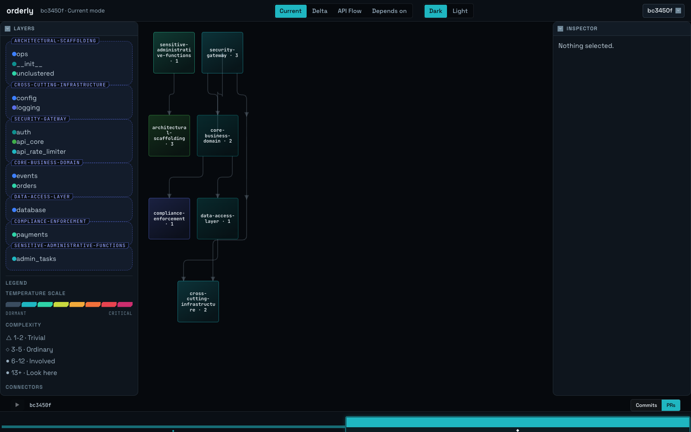
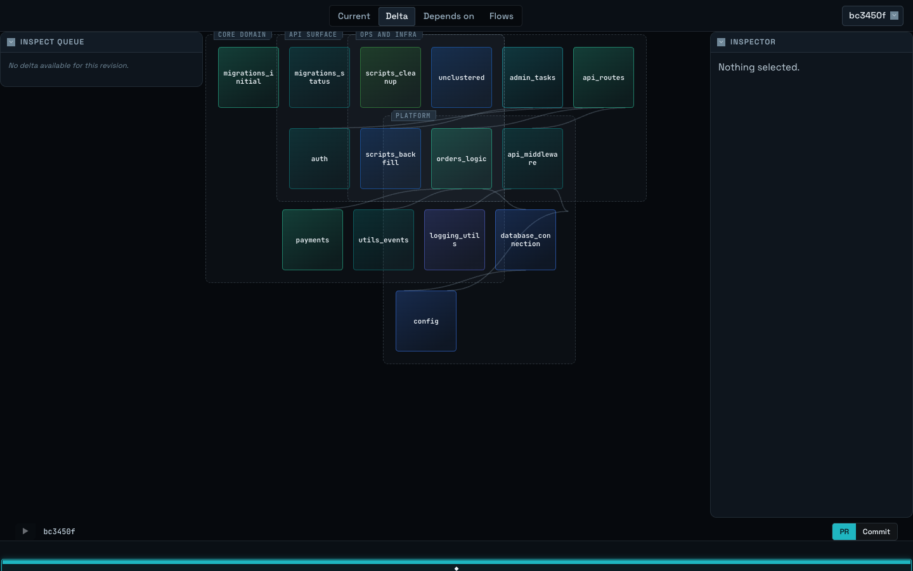
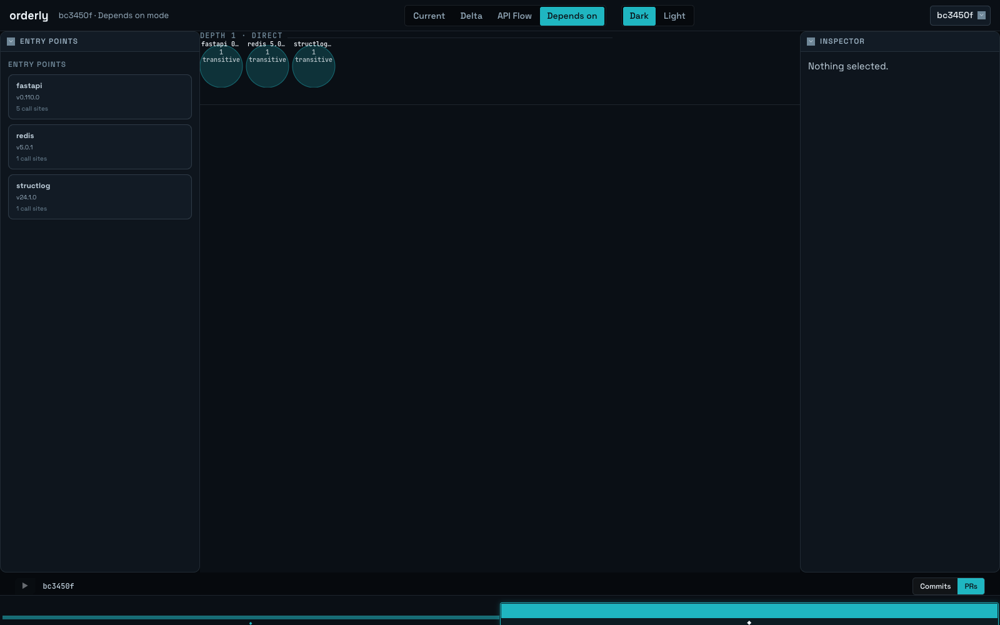
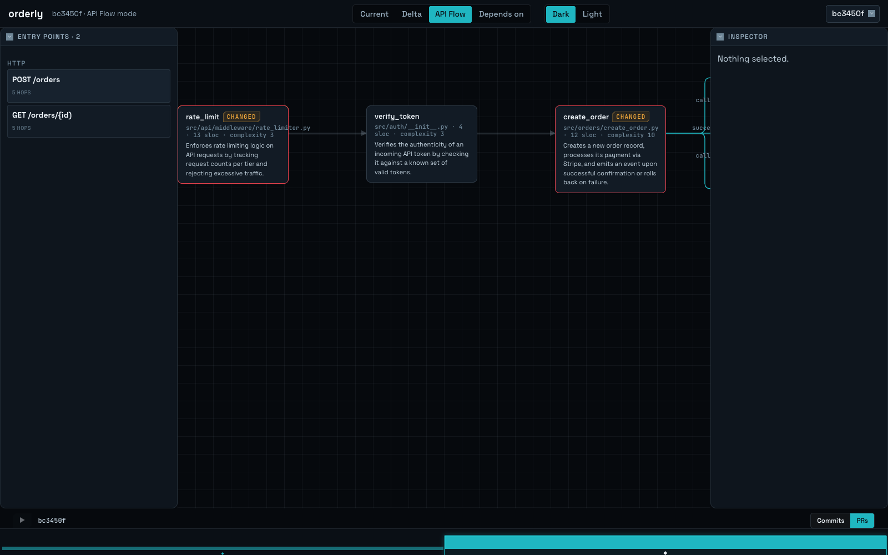
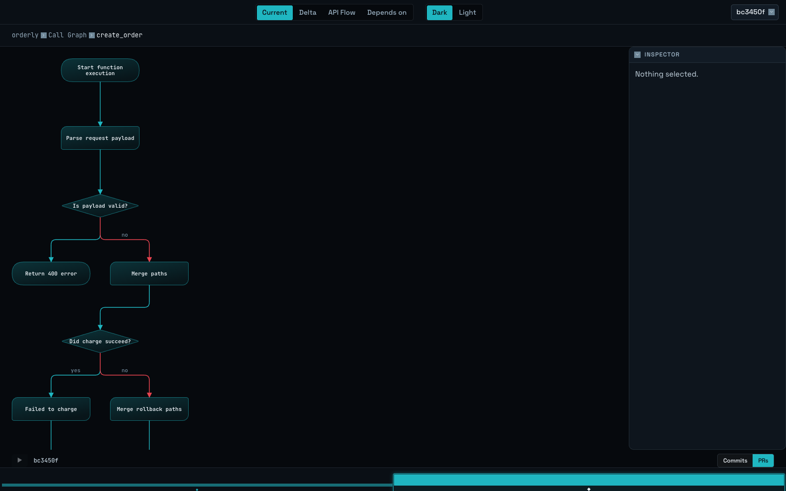
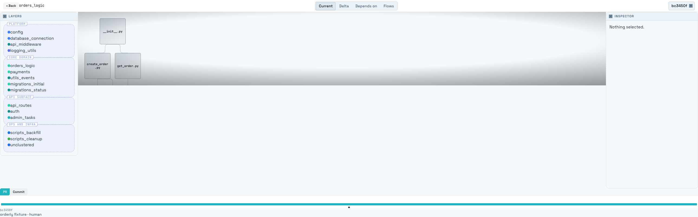

# scv — semantic code visualizer

> [!WARNING]
> **Work in progress.** scv is under active development and is not production-ready.
> Features, commands, and file formats may change without notice, and the software may
> contain bugs. It is provided "as is", without warranty of any kind, express or implied.
> You use it at your own risk; the authors accept no liability for any damage, data loss,
> or other consequences arising from its use.

A multi-view visualizer for software projects. It turns a repo into a
`SymbolGraph` (units, edges, externals) via static analysis, layers an LLM
Interpreter and a Differ on top, then serves it as a live, drillable tile map
in the browser.

See [`docs/design.md`](docs/design.md) for the full architecture, schema
contract, and pipeline. See [`docs/implement-analyze.md`](docs/implement-analyze.md)
and [`docs/implement-serve.md`](docs/implement-serve.md) for milestones.

## Requirements

- Node.js ≥ 24
- npm
- For the default LLM provider (`ollama`): a running local Ollama daemon

## Setup

```sh
npm install
```

This is a single npm workspace (`packages/*` + `packages/skins/*`) — one
install resolves and links every package.

## Build everything

```sh
npm run build
```

This runs `tsc -b` at the repo root, which builds **every package in
dependency order** in one pass (schema → extractor/layout → interpreter/
differ → cli/server/skins → ui) — you never need to build packages one at a
time. Re-running it is incremental: only packages whose inputs changed
rebuild.

To force a full rebuild from clean:

```sh
npx tsc -b --clean   # drop all build state
npm run build        # rebuild everything from scratch
```

## Commands

```sh
npm run build   # build every package, in dependency order, in one go
npm test        # run every package's tests (vitest)
npm run lint    # lint the whole repo (eslint)
npm run dev     # run the CLI package in dev mode (tsx, no build needed)
```

Scope any of these to a single package with `--workspace` if you only touched
one and want a faster loop:

```sh
npm test --workspace packages/extractor
npm run build --workspace packages/extractor
```

## Seeing a codebase end to end

Needs a provider for the Interpreter steps — `ollama` by default, see
[Configuring the LLM provider](#configuring-the-llm-provider) below.

```sh
# 0. build everything once
npm run build

# 1. extract a repo, lift semantics/clustering, and write a snapshot
node packages/cli/dist/bin.js analyze /path/to/repo

# 2. (optional) diff two revs once you have two snapshots analyzed
node packages/cli/dist/bin.js diff <from-sha> <to-sha> --scv-dir /path/to/repo/.scv

# 3. serve the JSON API (defaults: repo = cwd, port 3000)
node packages/cli/dist/bin.js serve /path/to/repo

# 4. serve the built UI, proxying /api/* to the server from step 3
#    (defaults: port 5173, --api-port 3000)
node packages/cli/dist/bin.js ui
```

Open `http://127.0.0.1:5173` in a browser. You get a layered tile map of the
repo's units (modules/classes/functions), each tile labeled with its name and
sloc/fan-in/fan-out, sized by SLOC and shaped by complexity, and colored by
the semantic layer the Interpreter clustered it into (a legend in the
bottom-left corner lists each layer present in the current view). Scroll to
zoom (anchored at the cursor) and drag to pan — real repos lay out wide and
flat, so zoom is how you read it. Click a tile to select it and open the
inspector tray; double-click to drill into it (double-click empty canvas to
ascend back out); hover to highlight what it depends on vs. what depends on
it. Connectors read as **A → B: A depends on B**, and dependencies are drawn
*above* their dependents — foundational modules (config, constants) sit at the
top of the canvas and the code that builds on them flows downward.

The top bar switches between four views:

- **Current** — the live tile map described above.
- **Delta** — diffs two revisions: tiles are colored by change status
  (added/removed/modified), an offset ring flags high risk, and a left-margin
  inspect queue ranks the units most worth reviewing first.
- **Depends on** — lists third-party externals (with ecosystem, version,
  direct/transitive depth) reached from the current selection.
- **API Flow** — traces a single `api_flow` end to end (the units one request
  actually touches, including every branch — e.g. success/failure — and any
  framework-wired DI/middleware ahead of the handler), with a step dot per
  changed unit in Delta mode.

A Replay timeline along the bottom scrubs through revisions (rev picker or
drag), toggles between PR- and commit-level density, and shows a per-rev
amount bar with human/agent authorship distinguished.

## Reviewing a PR

`scv analyze` always snapshots whatever revision is checked out (`git HEAD`),
so analyzing both endpoints of a PR means checking out each SHA in turn. Then
diff the two snapshots and serve.

```sh
# 0. build everything once
npm run build

# 1. analyze the PR's base and head revisions, one checkout each
git checkout <base-sha> && node packages/cli/dist/bin.js analyze /path/to/repo
git checkout <head-sha> && node packages/cli/dist/bin.js analyze /path/to/repo

# 2. diff base -> head
node packages/cli/dist/bin.js diff <base-sha> <head-sha> --scv-dir /path/to/repo/.scv

# 3. serve the API and UI
node packages/cli/dist/bin.js serve /path/to/repo
node packages/cli/dist/bin.js ui
```

Open `http://127.0.0.1:5173`, switch the top bar to **Delta**, and pick the
`base-sha`/`head-sha` pair in the rev picker. Tiles are colored by change
status (added/removed/modified); an offset ring flags high risk. Start from
the left-margin **inspect queue** — it ranks the units most worth reviewing
first, including `risk_changed` entries (a unit whose own diff is empty but
whose exposure changed, e.g. it crossed into the public API). Click a queue
entry to select its tile and open the inspector tray; double-click to drill
into a changed group and see which of its children actually moved.

For flow-level review — did this PR touch a specific request path — switch to
**API Flow**, pick the flow, and read the per-step dots: each changed unit
along that flow is marked, in call order, including any branch the flow takes.

## Screenshots

The UI runs on the CodeDream design system (`packages/design-system`), in
both a dark and a light skin.

| Current | Delta |
|---|---|
|  |  |

| Depends on | API Flow |
|---|---|
|  |  |

| Flowchart (dark) | Current (light) |
|---|---|
|  |  |

Known issue: the light skin's canvas background vignette is a known defect
(`GraphCanvas`'s radial-gradient background is hardcoded for the dark skin) —
tracked as a followup, not part of the design-system migration.

## Configuring the LLM provider

`scv analyze` (Pass A, Pass Docs, Pass B/C) and `scv diff` (Pass D + ranking) both call an LLM
provider, resolved from `<scvDir>/config.yaml` (default `.scv/config.yaml`).
No file → defaults to `ollama`.

On the very first run there's no `.scv/` yet, so there's nothing to hand-edit.
Pass `--provider`/`--model`/`--effort` to `analyze` instead — they're written
to `config.yaml` (creating `.scv/` if needed) before the run, so later
invocations reuse them without flags:

```sh
node packages/cli/dist/bin.js analyze /path/to/repo \
  --provider anthropic --model claude-sonnet-5
```

Or write `config.yaml` directly, any time:

```yaml
interpreter:
  provider: ollama       # ollama | anthropic | claude-cli
  model: qwen3.5:9b-mlx  # optional; each provider has its own default
  effort: low             # claude-cli only: low | medium | high | xhigh | max
```

- `ollama` — local, default model `qwen3.5:9b-mlx`. Requires a running
  Ollama daemon with that model pulled (`ollama list` to check; `--model`
  to point at whatever you actually have installed).
- `anthropic` — Anthropic API, default model `claude-sonnet-5`. Requires
  `ANTHROPIC_API_KEY` in the environment (never in `.scv/config.yaml`).
- `claude-cli` — shells out to the local `claude` CLI. Not used by default in
  this repo's own dev/test loop — see `packages/interpreter/src/providers/`
  for provider implementations.

Interpreter calls are content-cached at `<scvDir>/cache.sqlite`, so
re-running against an unchanged unit never re-invokes the provider.

Pass A fires one provider call per leaf unit (function/class), all in
parallel — fine for a small repo or fixture, but a large repo (hundreds of
units) against a local `ollama` daemon can open more concurrent connections
than it handles gracefully, surfacing as `fetch failed` in the analyze
output. If you hit that, analyze a smaller subtree first, or use a hosted
provider (`anthropic`) for the full run.

## Using the extractor as a library

The only consumable API today is `extractRepo`, which walks a repo on disk
and returns a `SymbolGraph`:

```ts
import { extractRepo } from "@scv/extractor";

const graph = extractRepo("/path/to/repo");

graph.units;     // modules, classes, functions — each with metrics, authors, hash
graph.edges;     // imports/calls between units
graph.externals; // third-party deps, with ecosystem, version, direct, depth, reached_by
```

Notes on what it does under the hood:

- **Languages:** Python and TypeScript, via tree-sitter grammars in `packages/extractor/src/grammars`.
- **Manifests:** reads `requirements.txt` (pypi) or `package.json` (npm) at the repo root to resolve pinned versions for externals.
- **VCS:** shells out to `git log --numstat` to compute per-file churn, commit counts, and per-author line contributions; returns empty data for non-git directories.
- **Determinism:** the same repo state always produces the same unit hashes — no LLM involved at this stage.

## Repo layout

```
packages/
  extractor/     # tree-sitter-based static analysis -> SymbolGraph
  interpreter/   # Pass A, Pass Docs, Pass B-D, Provider interface, content cache, checker, ranking
  differ/        # match, classify, blast radius, rollup
  schema/        # shared Zod/JSON schemas for the pipeline contract
  cli/           # `scv analyze` / `scv diff` / `scv serve` / `scv ui`
  server/        # Fastify API serving snapshots
  layout/        # pure layered layout engine (rank/order/place/route)
  skins/
    tiles/       # SVG rendering skin (wired into packages/ui)
    tiles3d/     # three.js rendering skin, orbit camera (wired into packages/ui)
    cityscape/   # three.js rendering skin, walk/fly camera + minimap (wired into packages/ui)
  ui/            # React app: canvas + inspector tray + Delta/Replay/Depends-on/API Flow views
docs/            # design docs, milestone plans, and the disposable Python mock
fixtures/        # sample repos used by tests (gitignored except small TS fixtures)
```

## Contributing

See [`CLAUDE.md`](CLAUDE.md) for coding rules, TDD workflow, and the git
branch → PR → merge flow used in this repo.

## Status

The full pipeline — Extractor → Interpreter (Pass A, Pass Docs, Pass B–D) → Differ — is
implemented end to end and wired into the CLI, server, and UI: `scv analyze`
extracts a repo and lifts semantics, clustering, and layer narration in one
pass; `scv diff` diffs two snapshots with LLM risk narration and produces a
ranked inspect queue. Point `scv` at a real repo, extract it, serve it, and
browse it as a live tile map today.

`scv analyze` is now incremental and artifact-aware: extraction is cached
per-file by content hash, and each interpreter stage (functions/docs/layers/
groups/flows) is persisted under `.scv/artifacts/<sha>/` and only recomputed
when its actual upstream inputs changed. `scv analyze [artifact]` computes a
single named artifact (freshening its dependencies first); `scv analyze --no-llm`
stops after extraction and writes a static-only snapshot. The on-disk/wire
`.scv/snapshots/<sha>.json` contract is unchanged — server and UI need no
changes.

Artifact writes are write-if-changed: each artifact stores a canonical
(sorted-key) content hash alongside its input hash, and a recompute or
`merge-semantics` run that yields the same content under the same input hash
leaves the file and its mtime untouched.

Authored semantics can be committed and shared. `merge-semantics` stamps each
entry with a sha-independent freshness fingerprint (unit hashes, call edges and
callee semantics; doc content; cluster/narration inputs for layers, groups and
flows). `scv export` publishes the entries authored at HEAD into the committed
store `.scv/semantics/` (function shards per source file, plus `docs.json`,
`layers.json`, `groups.json`, `flows.json`), keeping stale entries unchanged
and pruning entries whose unit or doc is gone. `scv hydrate [rev]` extracts
that revision (in place for a clean HEAD, otherwise in a temporary detached
worktree), reads the store committed at it and merges only the entries still
fresh there into `.scv/artifacts/<sha>/` — no LLM calls. Only `.scv/semantics/`
is commit-eligible; every other `.scv/` path stays ignored.

`scv check [--base <ref>] [--json]` recomputes every fingerprint for the
working tree against the committed store and lists each entry that is stale,
missing (a non-test unit, doc or global artifact with no entry) or orphaned
(its unit or doc is gone), with the `agent-analyze-*` skill that fixes it; it
exits 1 on any finding. `--base` limits function findings to units whose
fingerprint or committed entry changed since `git merge-base <ref> HEAD` —
including callers made stale through the call chain outside the diff — while
docs and global artifacts are always checked; an unresolvable base is an error.

Pass A is resumable. Every unit's result is persisted the moment it resolves,
keyed by the unit's structural hash, so an interrupted `scv analyze` costs at
most the units still in flight — a re-run reanalyzes only what is genuinely
missing or whose source actually changed. `functions.json` is flushed
periodically as a `partial` artifact (written atomically, and never mistaken
for a fresh one), so a run killed mid-pass still leaves a readable snapshot for
`--no-llm` to merge over. `scv analyze --scope all|changed|<unit-id globs>`
analyzes a repo in slices, e.g. `--scope 'u:src.handlers.**'`; globs match the
full unit id including the `u:` prefix. A provider response that fails
validation is never cached, so a retry can succeed instead of re-reading the
same bad text forever.

Pass A's block-level labels (used by Flowchart mode) now retry once, scoped
to just the decision/loop blocks the LLM left without a `trueLabel`/
`falseLabel` on the first call, instead of showing a generic branch label.
Pass B (file clustering) no longer asks an LLM anything. It partitions files by
weighted agglomerative single-linkage clustering over the import graph — pure,
provider-free, and byte-stable for identical structural input — because the old
contract asked which whole *directories* to union and so could not express a
split of one. Pass C keeps naming and prose and loses membership entirely, and
a layer's id is the hash of its file membership rather than of its name, so a
re-analysis that renames a layer no longer reads as one layer vanishing and
another appearing. A cluster whose membership is unchanged since the nearest
analyzed ancestor commit reuses that run's whole record verbatim and skips its
LLM call. Pass C-groups (layer grouping) still uses the deterministic-baseline
plus LLM-proposed-merges design: layers form the baseline, and anything the LLM
omits stays a singleton under its own name rather than falling into an
"unclustered" bucket.

**A6 validation against `fixtures/orderly`** (`docs/analyze.md`'s exit
criterion): the inspect queue correctly surfaces all 7/7 module-level
ground-truth entities (`fixtures/orderly/task/RL-114.deltas.json`) with a
local LLM in the loop — coverage is exact. Rank *order* does not yet match
the ground truth's order; ranking is the Interpreter's judgment call and its
quality depends on the underlying model, which a stronger model should
improve without any code change. `risk_changed` (flagging a unit whose own
diff is empty but whose exposure changed — more code now reaches it, or it
crossed into the public API) now ships, which is what admits the one
ground-truth entry that requires it (`tests.integration.test_orders`) into the
queue. It carries `amount: 0` deliberately: a change in exposure is worth
surfacing, but it is not evidence the unit's own code became likelier to break.

Canvas rendering has had a polish pass. Tile labels are measured per glyph class
rather than by a flat per-character average — which over-truncated names built
from narrow glyphs — and the complexity glyph's corner track is now reserved, so
long names stop short of it instead of running underneath. Legend group frames
reserve room for their floated label, which the tray's clipped overflow was
cutting off. The Depends-on rail is titled "Dependencies" (the "entry points"
label belongs to the API Flow view), and Delta mode on a revision with nothing to
compare now says so on the canvas rather than rendering an ordinary graph beside
a "no delta" notice.

The dependency graph's vertical orientation has been flipped. It used to place
entry points at the top and stack foundations at the bottom, so arrows converged
downward into `config`/`constants` and read as though those modules depended on
everything — the reverse of the truth. Ranks now render bottom-up: the
dependency is drawn above its dependent, matching the flowchart convention, and
the legend spells the convention out. The edge data is untouched — `from` is
still the importer and the arrowhead still lands on the imported module, so the
inspector's "Depends on"/"Used by" mean exactly what they did before; only the
screen orientation and which box face each port sits on changed. This applies to
the 2D canvas, the 3D/cityscape skin, and drill-down thumbnails alike, since all
three build from the same scene. The Flowchart view is unaffected — it lays out
control flow through its own pipeline and still runs top-down from the entry
block.

The 3D views have had a navigability pass, closing the gaps that made the
cityscape hard to move around in. Fly-mode drag is now delta-based, so
dragging back unwinds the turn instead of setting a rotation *rate* the camera
never stops obeying — that spin was also what made the minimap compass appear
to spin, so the compass needed no fix of its own once the camera stopped.
Walking toward a building drills into it and backing away ascends, with
hysteresis at the boundary so the threshold cannot flicker; a focused building
is never occluded by a faded one. Building height is now √-scaled like tile
area already was, which keeps one 2000-line file from flattening the rest of
the skyline, and a floor above the footprint width keeps the street from
reading as a plain of slabs. Facade edges are outlined so corner count — the
complexity bucket — stays readable edge-on at eye level, where a top-down
silhouette tells you nothing. The left rail now always shows the legend
(collapsing the layer tray used to take the legend with it) alongside a
controls guide that names the keys for whichever skin and camera are current.
For repositories too deep to drill through, a toolbar search box jumps
straight to a unit by name, and the legend collapses groups past the sixth.

The navigation hierarchy is being made structurally sound, following
`docs/plans/hierarchy-correctness-and-clustering-redesign.md`. Landed so far: a
single-root policy, so every unit but the system has a parent and test modules
sit in a `test_suite` container rather than dangling as orphans; referential
integrity validators that separate a structural defect from a legacy artifact by
severity, and so throw at analyze time while still letting an old snapshot on
disk load and serve; and real `group` units built deterministically from layer
ids rather than from LLM-chosen names, with rollup edges now carrying the
concrete edges they stand for, so a group-to-group edge reads as "14 calls"
instead of an opaque summed weight. Focusing a group no longer hides its coupling
to the rest of the system: an edge with one endpoint outside the focus becomes a
row in a connected-siblings tray, labelled with the sibling it addresses, the
direction, and how many edges collapsed into it. Hovering or pinning a row fills
the tiles inside the focus that sibling actually couples to, colouring each one by
which way its edges run — a tile coupled both ways is split between the two
colours rather than given a third — so the coupling is something you can see on
the canvas rather than a count to read. The row itself takes the same colour, and
nothing else on the canvas moves: a row leaves the ordinary connectors and
dimming untouched, because the sibling it names is off-canvas and any connector
drawn for it could only end somewhere arbitrary. The synthetic client-side
domain tier those group units replace is now gone, and with it the layer `group`
name string: regions, the legend, and the breadcrumb key on a group unit's id, so
renaming a group no longer reads as one group vanishing and another appearing,
and two groups that happen to share a name stay distinct. Clustering itself is
now deterministic too: an adversarial fixture pins the partition the algorithm
owes, the algorithm and its thresholds are recorded in snapshot provenance so a
moved boundary is explained by a rule rather than a number, and a split or merge
across revisions carries an explicit lineage relationship instead of reading as
churn.

Dense levels are now readable rather than truncated arbitrarily. Every edge rolls
up to the nearest *visible* tile on each side and edges sharing a resulting pair
merge into one connector carrying their summed weight, contributor count, and the
concrete edge ids behind it — and an aggregate keeps the weakest contributor's
confidence, so an inferred edge is never laundered into an evidenced one. Above
120 connectors at the focused level the view draws the highest-ranked, ordering
cross-group coupling ahead of heavier within-group edges, and says how many it
dropped rather than hiding them silently. Edges resting on model inference draw
dashed, including a bundle with one inferred contributor. This closes the plan:
every phase in it is now implemented and merged.

A coding agent working in a repo already knows the what/how/when/where/why for
the units it just wrote or read — asking it to phone out to an LLM provider to
re-derive that would be a wasted second call. `scv merge-semantics
<pending-file> [--scope all|changed|<globs>] [--with-clustering] [--sha <sha>]`
lets it write that knowledge to a `.scv/pending/<sha>/semantics.json` file
instead and inject it straight into the artifact cache with zero LLM calls:
`scv analyze --no-llm` first (so unit ids are real), the agent authors
Pass-A-shaped function/class semantics and, with `--with-clustering`,
Pass-C-shaped layer narration against the real deterministic clustering (Pass
B), then `scv merge-semantics` writes correctly-hashed `functions.json`/
`layers.json` artifacts a subsequent `scv analyze` reuses as-is. An unmatched
unit id or a pending layer that doesn't match a real cluster is warned and
skipped, never a hard failure.

That path is now complete for every stage. `--with-docs` merges agent-authored
README/`docs/` extracts, so the zero-LLM route no longer leaves `docs.json`
empty and clustering no longer runs blind to the repo's own vocabulary, and
`--with-groups`/`--with-flows` cover group and flow narration. Block units —
the Flowchart view's data — are pure AST structure, so they are built
deterministically on every path rather than only inside the LLM pass: a repo
analyzed entirely through the agent path gets working flowcharts. Alongside
these, `.agents/skills/agent-analyze-*` ships one skill per stage plus an
`agent-analyze-repo` umbrella that runs the chain in dependency order. A
deterministic stage (`clusters`) genuinely computes under `--no-llm` instead of
empty-defaulting, but refuses to compute over an empty-defaulted dependency —
naming the skill to run — because a `clusters.json` derived from nothing is
cache-fresh and indistinguishable from a good one on the next run.

| Package | What it does | Status |
|---|---|---|
| `packages/extractor` | Parses a repo (Python + TypeScript via tree-sitter), resolves imports/calls into units and edges, reads `requirements.txt`/`package.json` manifests, and pulls per-file churn/authors from `git log` | Implemented |
| `packages/schema` | Zod schemas (+ generated JSON Schema) for the `SymbolGraph`/`UnitGraph` contract | Implemented |
| `packages/interpreter` | Pass A (leaf semantics + branch labels, with scoped retry on incomplete blocks), Pass Docs (repo README/docs structural extraction), Pass B (deterministic agglomerative single-linkage file clustering over the import graph — no LLM), Pass C (architecture narration + branch-preserving API flow tracing, including framework DI/middleware steps; Pass C-groups uses a layer baseline plus LLM-proposed merges), Pass D (five-axis risk narration) + inspect-queue ranking, all via `Provider` (`ollama`, `anthropic`, `claude-cli`) + content cache | Implemented |
| `packages/differ` | Matches units across snapshots, classifies changes from hashes, computes blast radius and formula-floor risk, rolls amount/risk up to every ancestor; overrides risk with Pass D + ranking. Emits `added`/`removed`/`modified`/`risk_changed`; `moved` and `renamed` are deliberately unsupported — they need rename-detection heuristics this differ does not implement | Implemented |
| `packages/cli` | `scv analyze` — extracts + lifts a repo into a `scv/1` snapshot; `scv diff <from> <to>` — diffs two snapshots into a `scv-delta/1` file with a ranked inspect queue; `scv serve` — serves the JSON API for a repo's `.scv` dir; `scv ui` — serves the built SPA, proxying `/api/*` to a running `scv serve`; `scv merge-semantics` — injects agent-authored Pass A/C semantics from a pending-semantics file into the artifact cache, zero LLM calls; `scv export` / `scv hydrate [rev]` — publish authored semantics to the committed `.scv/semantics/` store and seed any revision's artifacts from it; `scv check [--base <ref>]` — list stale, missing and orphaned committed entries with the skill that fixes each | Implemented |
| `packages/server` | Fastify API serving snapshots (`/api/revs`, `/api/snapshot/:sha`, `/api/search`, `/api/delta/:from/:to`, ...) | Implemented |
| `packages/layout` | Pure Sugiyama-style layered layout engine (rank → order → place → route), dummy-node expansion, port spreading, recursive mini-maps | Implemented |
| `packages/skins/tiles` | SVG rendering skin: chamfered tiles colored by semantic layer, complexity glyphs + numeric labels, dependency-highlight links. Wired into `packages/ui` today | Implemented |
| `packages/skin-contract` | The `Skin` contract itself: `node`/`link`/`region`/`theme`, the declared `camera` model, and `navigate(intent) -> CameraMove`. Generic in its drawable type (`Skin<TNode, TLink, TRegion>`), so a 2D host cannot be handed a `THREE.Group`. Depends on `packages/layout` and nothing else — no renderer, no `three` | Implemented |
| `packages/skins/tiles3d` | three.js rendering skin: same scene extruded to prisms/cylinders (sides = complexity, height = sloc via `SceneNode.depth`), orbit camera, CSS2D labels, layer hue on the facades, delta as emissive glow, risk beacons above the roofline, density-gated links; zero changes under `packages/layout`. Selectable as **3D** in the toolbar | Implemented |
| `packages/skins/cityscape` | The walkable skin: the same buildings as `tiles3d` (imported, not reimplemented — one encoding, one place), plus a ground plane on the 2D canvas's grid and a top-down minimap projection. Declares `camera: "walk"`, so the host attaches pointer-lock walk and fly controls instead of orbit, and shows the minimap — at eye level that minimap is the only instrument that answers "which way is up the dependency graph?" (`docs/serve.md#6`). Selectable as **City** in the toolbar | Implemented |
| `packages/ui` | React app: canvas (select/drill/ascend, hover-highlight) + inspector tray + Delta view (rev picker, status/amount/risk tile coloring, rollup fallback for collapsed ancestors, left-margin inspect queue) + Replay timeline (rev scrub, PR/commit density toggle, per-rev amount bars, human/agent distinction) + Depends-on view + API Flow view + Flowchart view (with a `‹ Back` button) + find-a-unit search that drills to a
result's parent before selecting it, fully migrated onto `packages/design-system` (the CodeDream design system) — no bespoke `app.css` remains | Implemented |
| `packages/design-system` | CodeDream design tokens (color, type, spacing, radius) + shared components (`Toolbar`, `SegmentedControl`, `Select`, `Tray`, `Card`, `Badge`, `BubbleChart`, ...) consumed by `packages/ui` | Implemented |

A disposable Python prototype of the *full* pipeline (extract → interpret →
diff → render) lives at [`docs/mock/`](docs/mock/README.md) and is useful for
seeing the end-to-end shape of the product before the LLM stages catch up.

## License

Licensed under the [Apache License, Version 2.0](LICENSE).
